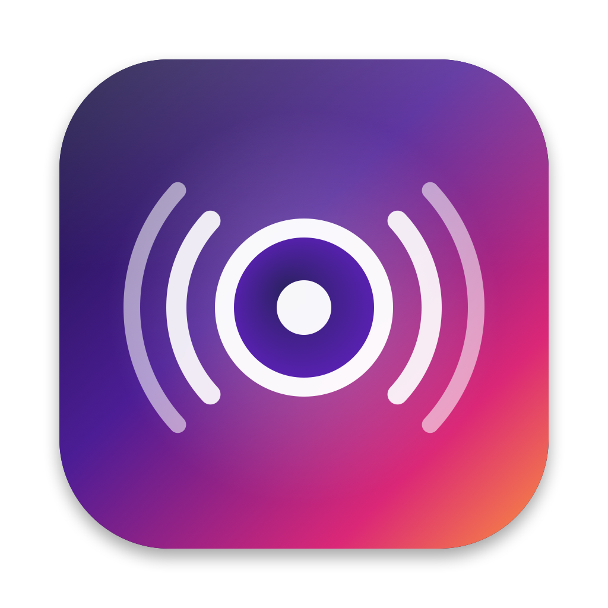
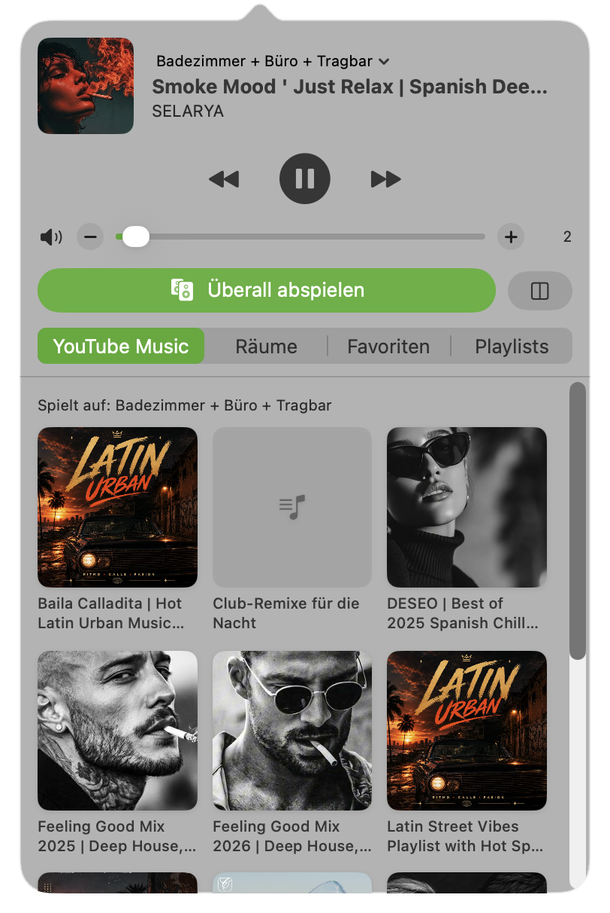
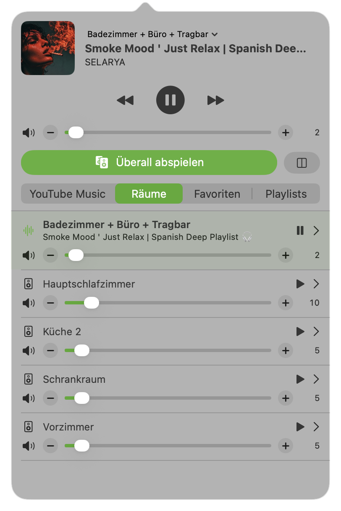

# SonosBar

Native macOS-Menüleisten-App (Swift/SwiftUI) zur Steuerung eines Sonos-Systems – direkt im lokalen Netzwerk, ohne Sonos-Konto, ohne Cloud.

Entwickelt von **Markus Übeleis**.

<p>
  
  
</p>

## Download

**[→ Neueste Version (DMG)](https://github.com/uebelmar/sonos-bar/releases/latest)**

DMG öffnen, `SonosBar` in den Ordner *Programme* ziehen, starten. Die App ist mit Developer ID signiert (Team *flinkest FlexCo*) und von Apple notarisiert.
Beim ersten Start fragt macOS nach **Zugriff auf das lokale Netzwerk** – erlauben, sonst findet die App keine Lautsprecher
(nachträglich: *Systemeinstellungen → Datenschutz & Sicherheit → Lokales Netzwerk*).

Voraussetzungen: macOS 14 Sonoma oder neuer, Sonos S2, Mac im selben Netzwerk wie die Lautsprecher.

## Funktionen

- **Menüleisten-Symbol** – Linksklick öffnet das Fenster, Rechtsklick: *Neu verbinden*, *Beim Anmelden starten*, *Beenden*. Kein Dock-Symbol.
- **Now Playing** – Cover, Titel, Interpret, ⏮ ⏯ ⏭, Auswahl der aktiven Gruppe.
- **Überall abspielen** – holt alle erreichbaren Lautsprecher in die aktive Gruppe; Sonos spielt dann synchron. Nicht erreichbare Lautsprecher (z. B. ein Roam/Move im Bluetooth-Modus) werden übersprungen und angezeigt. Daneben: alle Gruppen auflösen.
- **Lautstärke** – pro Gruppe (Verhältnis zwischen den Lautsprechern bleibt erhalten) und pro Lautsprecher, Slider plus **−/+** (2er-Schritte, gedrückt halten wiederholt), Stummschalten.
- **Räume** – Gruppen auf einen Blick, aufklappbar mit Einzel-Lautstärke und Häkchen zum Gruppieren.
- **YouTube Music / Favoriten / Playlists** – Cover-Karten, Klick spielt auf der aktiven Gruppe. Einträge, die der Dienst nicht mehr liefert, werden markiert und können direkt aus *Mein Sonos* gelöscht werden (auch per Rechtsklick).

### Grenze: YouTube Music

Die App zeigt die YouTube-Music-Playlists und -Mixe, die in der Sonos-App als **Favorit („Mein Sonos“, ♡)** gespeichert sind.
Neue Playlist in der Sonos-App mit ♡ speichern → erscheint automatisch in SonosBar.

Die komplette YouTube-Music-Bibliothek lässt sich nicht durchsuchen: Googles Sonos-Schnittstelle (SMAPI) akzeptiert nur die
offiziellen Sonos-Apps (`403 PERMISSION_DENIED`, verlangt einen gerätegebundenen, verschlüsselten API-Key). Das wird bewusst nicht umgangen.

## Wie es funktioniert

SonosBar spricht die lokale UPnP/SOAP-API der Lautsprecher (`http://<ip>:1400`), dieselbe, die auch die Sonos-Apps im LAN verwenden:

| Aufgabe | Service / Aktion |
|---|---|
| Lautsprecher finden | Bonjour `_sonos._tcp`, danach `ZoneGroupTopology#GetZoneGroupState` |
| Favoriten / Playlists | `ContentDirectory#Browse` (`FV:2`, `SQ:`), löschen mit `DestroyObject` |
| Playlist abspielen | `RemoveAllTracksFromQueue` → `AddURIToQueue` → `SetAVTransportURI(x-rincon-queue:…)` → `Play` |
| Stream / Mix / Radio | `SetAVTransportURI(uri, resMD)` → `Play` |
| Gruppieren | `SetAVTransportURI(x-rincon:<Koordinator>)`, lösen mit `BecomeCoordinatorOfStandaloneGroup` |
| Gruppen-Lautstärke | `GroupRenderingControl#SnapshotGroupVolume` + `SetGroupVolume` |

Status wird nur bei geöffnetem Fenster alle 2,5 s abgefragt.

## Entwickeln

```bash
brew install xcodegen create-dmg
xcodegen generate                      # erzeugt SonosBar.xcodeproj (nicht eingecheckt)
open SonosBar.xcodeproj
cd SonosKit && swift test              # Parser-/SOAP-Tests mit echten (anonymisierten) Antworten
```

Aufbau:

```
project.yml               xcodegen-Projekt (App-Target, Signing, Info.plist, Entitlements)
SonosBar/                 @main, Info.plist, Entitlements – sonst nichts
SonosKit/                 Swift Package mit der gesamten Logik und UI
  Sources/SonosKit/
    SOAP.swift            SOAP-Envelope, Request, Fault-Parsing
    XML.swift             kleiner DOM über XMLParser
    SonosClient.swift     typisierte UPnP-Aktionen eines Lautsprechers
    Discovery.swift       Bonjour-Suche
    Models.swift          Topologie- und DIDL-Parsing, MediaItem
    SonosStore.swift      App-State, Polling, alle Aktionen
    Views.swift           SwiftUI-Oberfläche
    AppDelegate.swift     Status-Item, Popover, Kontextmenü
  Tests/SonosKitTests/    Unit-Tests + opt-in Live-Test
scripts/release.sh        Archive → Developer-ID-Export → DMG → Notarisierung → Stapling
scripts/install.sh        nach /Applications kopieren, Autostart einschalten
scripts/make-icon.swift   rendert das App-Icon (docs/icon.png → Assets.xcassets)
```

Live-Test gegen ein echtes System (lädt jeden YouTube-Music-Favoriten, ohne abzuspielen):

```bash
SONOS_LIVE=1 SONOS_HOST=192.168.1.20:1400 swift test --filter liveFavorites
```

Startargumente: `--register-login-item` (Autostart einschalten), `--show-popover [--tab youtube|rooms|favorites|playlists]` (für Screenshots).

### Release

```bash
ASC_KEY_ID=… ASC_ISSUER_ID=… ASC_KEY_PATH=~/.appstoreconnect/private_keys/AuthKey_….p8 scripts/release.sh
gh release create v1.0 build/release/SonosBar-1.0.dmg
```

Wer selbst baut, ersetzt in `project.yml` und `scripts/ExportOptions.plist` die Team-ID durch die eigene.

## Lizenz

MIT © 2026 Markus Übeleis – siehe [LICENSE](LICENSE). Nicht mit Sonos, Inc. oder Google verbunden; „Sonos“ und „YouTube Music“ sind Marken ihrer Inhaber.
